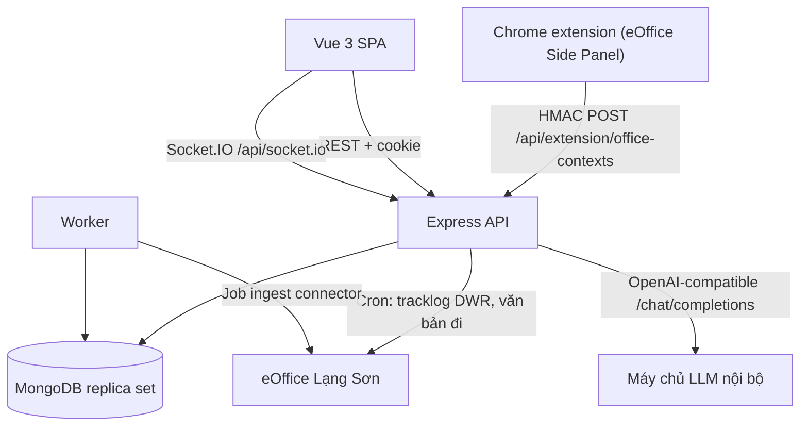
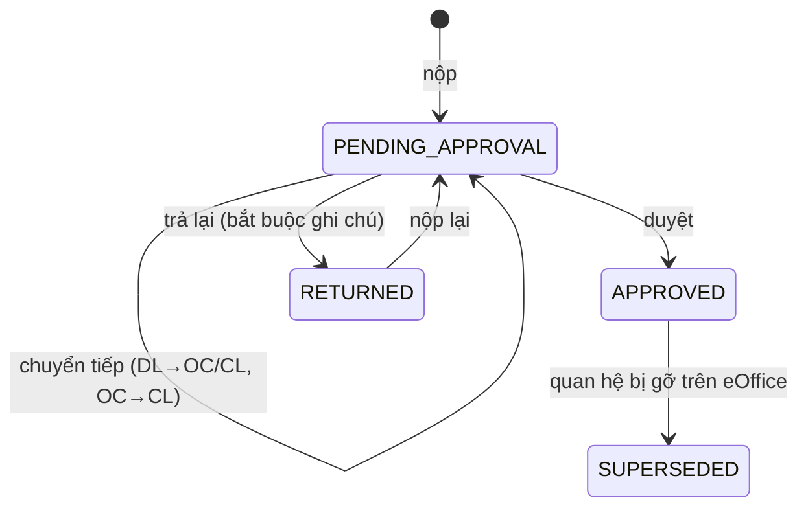
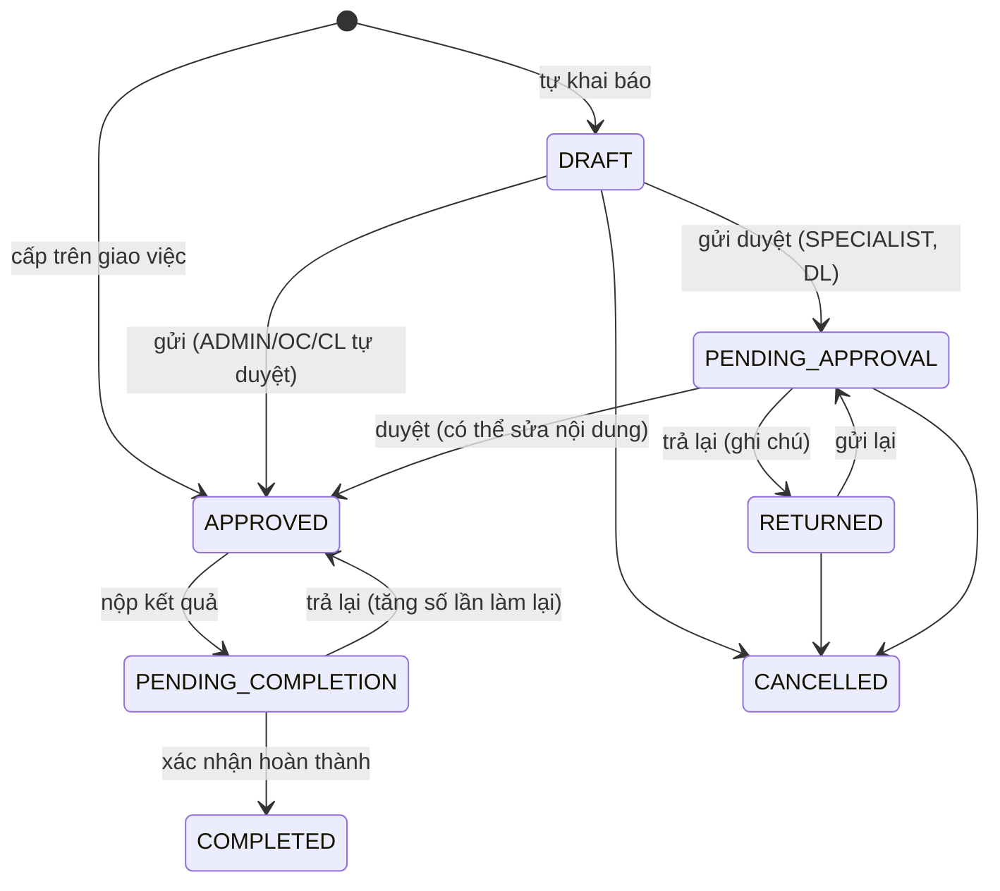

# eWork / SCMager — Đặc tả hệ thống (theo mã nguồn hiện tại)

> **Ngày xuất:** 2026-11-20
> **Nguồn:** đọc trực tiếp mã nguồn `apps/api` và `apps/web` tại thời điểm xuất. Tài liệu này thay thế cho `SYSTEM_SPEC.md` và `PROJECT_SPEC_AND_FR.md` (bản 27/07/2026). Hai bản đó đã cũ và mô tả một số thứ không còn khớp với code.
> **Quy ước:** đường dẫn `S/` là `apps/api/src/services/`, `M/` là `apps/api/src/models/`, `W/` là `apps/web/src/`.

---

## Mục lục

1. [Tổng quan](#1-tổng-quan)
2. [Kiến trúc và hạ tầng](#2-kiến-trúc-và-hạ-tầng)
3. [Xác thực, vai trò và phạm vi dữ liệu](#3-xác-thực-vai-trò-và-phạm-vi-dữ-liệu)
4. [Mô hình dữ liệu](#4-mô-hình-dữ-liệu)
5. [FR-01 Văn bản đến (nhiệm vụ)](#5-fr-01-văn-bản-đến-nhiệm-vụ)
6. [FR-02 Văn bản đi (sản phẩm) và liên kết kết quả](#6-fr-02-văn-bản-đi-sản-phẩm-và-liên-kết-kết-quả)
7. [FR-03 Khiếu nại điểm, "Không cần làm", hoàn thành thủ công](#7-fr-03-khiếu-nại-điểm-không-cần-làm-hoàn-thành-thủ-công)
8. [FR-04 Khai báo công việc (Lịch công việc)](#8-fr-04-khai-báo-công-việc-lịch-công-việc)
9. [FR-05 Hiệu suất và KPI](#9-fr-05-hiệu-suất-và-kpi)
10. [FR-06 Báo cáo quá hạn và giao việc muộn](#10-fr-06-báo-cáo-quá-hạn-và-giao-việc-muộn)
11. [FR-07 Báo cáo KT-XH cấp xã (IOC)](#11-fr-07-báo-cáo-kt-xh-cấp-xã-ioc)
12. [FR-08 Dashboard điều hành và Trợ lý AI giao việc](#12-fr-08-dashboard-điều-hành-và-trợ-lý-ai-giao-việc)
13. [FR-09 Thu thập dữ liệu (Extension, cron, connector)](#13-fr-09-thu-thập-dữ-liệu-extension-cron-connector)
14. [FR-10 Thông báo, realtime, audit](#14-fr-10-thông-báo-realtime-audit)
15. [FR-11 Quản trị: người dùng, tổ chức, phòng ban, cấu hình](#15-fr-11-quản-trị-người-dùng-tổ-chức-phòng-ban-cấu-hình)
16. [Frontend](#16-frontend)
17. [Danh mục API](#17-danh-mục-api)
18. [Ghi chú hiện trạng và điểm lệch](#18-ghi-chú-hiện-trạng-và-điểm-lệch)

---

## 1. Tổng quan

eWork / SCMager là hệ thống quản lý công việc và chấm điểm KPI cho cơ quan hành chính cấp xã. Hệ thống:

- lấy văn bản đến và văn bản đi từ eOffice Lạng Sơn (qua Chrome extension và cron đồng bộ trạng thái);
- xác định người xử lý chính, theo dõi hạn xử lý, nút thắt và giao việc muộn;
- cho phép chuyên viên nộp sản phẩm (văn bản đi) làm kết quả cho nhiệm vụ, có luồng duyệt;
- quản lý khai báo công việc ngoài văn bản (lịch công việc) với luồng duyệt và hoàn thành;
- tính điểm KPI tháng theo quy tắc trừ 25%, nhập/xuất bảng điểm PL4 (Excel);
- quản lý báo cáo KT-XH cấp xã, trích xuất chỉ tiêu bằng LLM, hiển thị dashboard IOC;
- có trợ lý AI tạo khai báo công việc qua hội thoại.

## 2. Kiến trúc và hạ tầng

### 2.1. Monorepo

| Thành phần | Công nghệ |
|---|---|
| Quản lý repo | pnpm workspace + Turbo (`pnpm dev`, `pnpm build`, `pnpm test`) |
| `apps/api` | Node.js, Express 5, TypeScript, Mongoose 9, Socket.IO 4, Playwright, axios + tough-cookie, ExcelJS, multer, pdf-parse, mammoth |
| `apps/web` | Vue 3.5, vue-router 4.5, Vite 5, Tailwind CSS 4, reka-ui / radix-vue (kiểu shadcn-vue), lucide, @vueuse/core, @vueuse/motion, socket.io-client |
| `packages/` | eslint-config, typescript-config, scripts |
| Kiểm thử | `tsx --test` (Node test runner), `src/test/*.test.ts` |

### 2.2. Tiến trình chạy

| Tiến trình | Entry | Vai trò |
|---|---|---|
| API | `apps/api/server.ts` (`APP_ROLE=api`, cổng `PORT`, mặc định 8004) | REST, Socket.IO, cron đồng bộ trạng thái (nếu `EXTENSION_STATUS_INGEST_AUTOSTART=true`), seed admin mặc định và chỉ tiêu xã |
| Worker | `apps/api/worker.ts` (`APP_ROLE=worker`) | Poll mỗi `WORKER_POLL_MS` (mặc định 15s): xử lý job ingest của connector và phát thông báo |
| Web | `vite preview`, cổng 8005 | SPA |



### 2.3. Express app (`apps/api/src/app.ts`)

- `cors()` mở mọi origin; JSON/urlencoded tối đa 50 MB.
- Header `x-correlation-id` được nhận nếu hợp lệ (`^[A-Za-z0-9._-]{8,128}$`), nếu không thì sinh UUID; trả lại trong response.
- Mọi response có header `no-store`.
- Router mount ở cả `/api` và `/`.
- Lỗi trả dạng `{ error: { code, message, details? } }`. Trùng khoá → 409, Validation/Cast → 400, còn lại → 500.
- Các thao tác thay đổi trạng thái (khai báo công việc, liên kết kết quả) dùng `revision` để khoá lạc quan; gửi `revision` cũ → 409.

### 2.4. Health

- `GET /livez`: trạng thái process.
- `GET /readyz`, `GET /ping`: kiểm tra mongo, secret provider, job backend (mongo). 200 nếu ok, 503 nếu degraded.

### 2.5. Triển khai

- **docker-compose:** `mongodb` (mongo 8.0.12, replSet `rs0`, 9006→27017), `mongo-init` (`rs.initiate`), `api` (9010→8004, healthcheck `/api/readyz`), `worker` (cùng image), `web` (9011→8005). `GOVERNANCE_GATE_APPROVED="false"`. Tag ảnh lấy từ `IMAGE_TAG`.
- **Dockerfile:** `node:24.11.1-bookworm-slim`, build pnpm cho api và web, cài Playwright Chromium tại `/ms-playwright`, chạy bằng user `node`.
- **nginx:** `ework.naot.me`, `ework.expsolution.io`: `/` → `:9011`, `/api/` → `:9010` (có WebSocket), `client_max_body_size 25m`.
- **Upload:** lưu trên đĩa tại `UPLOAD_DIR` (mặc định `uploads`), tối đa 20 MB/file, 10 file. Báo cáo xã lưu ở `uploads/commune-reports/<năm>/`.

### 2.6. Biến môi trường (chỉ tên)

| Nhóm | Biến |
|---|---|
| Lõi | `NODE_ENV`, `APP_ROLE`, `PORT`, `MONGO_URI` (`MONGODB_URI`), `JWT_SECRET` (≥32 ký tự ở production), `SECRET_PROVIDER` (`env`), `WORKER_POLL_MS`, `UPLOAD_DIR`, `WORK_TIMEZONE_OFFSET_MINUTES`, `BACKUP_OUTPUT` |
| Admin mặc định | `DEFAULT_ADMIN_USERNAME`, `DEFAULT_ADMIN_PASSWORD`, `DEFAULT_ADMIN_EMAIL` |
| Extension | `EWORK_EXT_SECRET_KEY` |
| Cron đồng bộ | `EXTENSION_STATUS_INGEST_AUTOSTART`, `EXTENSION_STATUS_SYNC_ENABLED`, `EXTENSION_STATUS_INGEST_BATCH_SIZE`, `EXTENSION_STATUS_INGEST_RETRY_BASE_MS`, `EXTENSION_STATUS_INGEST_RETRY_MAX_MS`, `LANGSON_INGEST_CRON_INTERVAL_MS`, `LANGSON_INGEST_CRON_JITTER_PERCENT`, `LANGSON_INGEST_CRON_LOG_LIMIT`, `LANGSON_INGEST_SESSION_HEAL_DELAY_MS` |
| eOffice Lạng Sơn | `LANGSON_APP_URL`, `LANGSON_APP_ORIGIN`, `LANGSON_PROBE_URL`, `LANGSON_IDP_HOST`, `LANGSON_USERNAME`, `LANGSON_PASSWORD`, `LANGSON_PROFILE_DIR`, `LANGSON_COOKIE_STORE`, `LANGSON_USER_AGENT`, `LANGSON_NAV_TIMEOUT`, `LANGSON_REQUEST_TIMEOUT`, `LANGSON_MAX_REDIRECTS`, `LANGSON_DWR_DOC_PAGE_LIMIT`, `LANGSON_ORG_PREFIX`, `PLAYWRIGHT_BROWSERS_PATH` |
| LLM | `BASE_URL`, `API_KEY`, `MODEL`, `ASSIGNMENT_AI_URL`, `ASSIGNMENT_AI_MODEL`, `ASSIGNMENT_AI_API_KEY` |
| Khác | `GOVERNANCE_GATE_APPROVED`, `IMAGE_TAG`, `MONGO_INITDB_ROOT_USERNAME`, `MONGO_INITDB_ROOT_PASSWORD` |

## 3. Xác thực, vai trò và phạm vi dữ liệu

### 3.1. Phiên đăng nhập

- JWT HS256, payload `{id, email, exp}`, lưu trong cookie HttpOnly `scmager_session`. Không có Bearer header, không có refresh token.
- Production: `SameSite=None; Secure` (để chạy trong iframe Side Panel của extension). Môi trường khác: `Lax`.
- Hạn phiên: 1 ngày; 14 ngày nếu chọn `remember`.
- Đăng nhập bằng `login` / `username` / `email` (không phân biệt hoa thường) + `password`. Sai → 401; user không ACTIVE hoặc role không hợp lệ → 403.
- Mật khẩu băm PBKDF2-SHA512, 120.000 vòng, salt 16 byte (`pbkdf2$iter$salt$hash`).
- `requireAuth`: verify JWT → nạp lại user từ DB → bắt buộc `status = ACTIVE` → gắn `req.currentUser`.
- Đổi mật khẩu: tự đổi phải nhập đúng `currentPassword`; đổi cho người khác phải có quyền quản lý user đó. Mật khẩu mới ≥6 ký tự. Ghi audit `USER_PASSWORD_CHANGED`.

### 3.2. Vai trò

| Code | Tên | Level |
|---|---|---|
| `ADMIN` | Quản trị hệ thống | 0 |
| `OFFICE_CHIEF` | Chánh văn phòng | 1 |
| `COMMUNE_LEADER` | Lãnh đạo UBND xã | 2 |
| `DEPARTMENT_LEADER` | Lãnh đạo phòng | 3 |
| `SPECIALIST` | Chuyên viên | 4 |

Không có middleware RBAC chung. Quyền được kiểm trong từng service theo `role.code` và `level`; mảng `permissions` của Role không được dùng. Nhóm **quản lý** (MANAGER_ROLES) gồm ADMIN, OFFICE_CHIEF, COMMUNE_LEADER, DEPARTMENT_LEADER.

### 3.3. Phạm vi dữ liệu (tenant = organization)

| Vai trò | Phạm vi |
|---|---|
| ADMIN (platform, không gắn tổ chức) | Bỏ qua lọc tổ chức; duy nhất được quản lý tổ chức, tạo/sửa/xoá connector |
| ADMIN (tenant, có tổ chức) | Bỏ qua lọc tổ chức ở phần lớn service; kích hoạt/tắt connector |
| ADMIN (chung) | Quản lý ingest cron, cấu hình hệ thống, extension version |
| OFFICE_CHIEF, COMMUNE_LEADER | Toàn bộ tổ chức của mình (văn bản, khai báo, hiệu suất). Quản lý mọi user không phải ADMIN. Chỉ OFFICE_CHIEF (level ≤1) quản lý phòng ban |
| DEPARTMENT_LEADER | Văn bản giao cho phòng mình, cho mình, hoặc có người xử lý chính thuộc phòng. User/báo cáo giới hạn trong phòng. Chỉ quản lý user có level lớn hơn |
| SPECIALIST | Văn bản mình được giao / đang xử lý / là người nhận chính. Không xem báo cáo quá hạn. Chỉ tự sửa họ tên và mật khẩu. Không giao việc cho người khác |

- Audit log: ADMIN hoặc level ≤2.
- System admin (`isSystemAdmin`) không xoá, không khoá, không đổi username được.

## 4. Mô hình dữ liệu

### 4.1. Danh mục collection (`apps/api/src/models/`)

| Model | Mục đích | Ghi chú |
|---|---|---|
| `User`, `Role`, `Organization`, `Department` | Người dùng, vai trò, tổ chức, phòng ban | Organization.type: DISTRICT/COMMUNE/DEPARTMENT/OTHER; Department có `isOffice`, `leader` |
| `OfficeDocumentContext` | Văn bản đến (nhiệm vụ) và văn bản đi (sản phẩm) | Model trung tâm, xem 4.2 |
| `DocumentResultLink` | Liên kết sản phẩm → nhiệm vụ, có luồng duyệt | Xem 4.3 |
| `WorkDeclaration` | Khai báo công việc / lịch công việc | Xem mục 8 |
| `LeadershipAssessment` | Điểm đánh giá lãnh đạo phòng theo tháng | Unique (org, user, period) |
| `CommuneReport`, `CommuneMetric` | Báo cáo KT-XH và chỉ tiêu | Xem mục 11 |
| `ChatSession`, `ChatContent`, `AiTaskDraft` | Trợ lý AI giao việc | Draft TTL 1 giờ |
| `Notification`, `AuditLog` | Thông báo, nhật ký | |
| `Connector`, `IngestJob`, `IngestRun`, `DeadLetter` | Connector và hàng đợi ingest | |
| `ConnectorMapping`, `GovernancePolicy`, `MigrationQuarantine` | Quản trị dữ liệu, migration | Hầu như không được dùng (mục 18) |
| `Config` | Cấu hình key/value | Ví dụ `extension.currentVersion` |
| `Timesheet`, `WorkPolicy` | Chấm công theo ngày, chính sách công việc | Timesheet chưa có trang web |
| `Task` | Nhiệm vụ kiểu cũ | Chỉ dùng trong script backfill |
| `AiJob`, `FileAttachment` | Định nghĩa sẵn | `AiJob` không được dùng |

### 4.2. OfficeDocumentContext

| Nhóm | Trường chính |
|---|---|
| Định danh | `organizationId`, `tenantResolution` (SENDER/RECIPIENT/DRAFTING_USER/DEPARTMENT/AMBIGUOUS/UNRESOLVED/MANUAL), `origin` (EXTENSION/MANUAL/MANUAL_INGEST), `sourceHost`, `pageType` (`incoming` / `outgoing` / `outgoing_c2`), `externalDocumentId` (unique cùng sourceHost + pageType), `normalizedSoKyHieu`, `sourceUrl`, `observedAt` |
| `observation` | subject (trích yếu), soKyHieu, receivedDate, dueDate, createdDate, drafting\*/sender\*, relatedIncomingSoKyHieu, comment, point, reworkCount, note, `recipients[]` (role: main/collaborator/view/co_send/co_process; entityType: person/unit), timeline |
| `statusSync` | status (PENDING_RESPONSE/RESPONSE_CREATED/IN_PROGRESS/COMPLETED), completed, completedRule, completedAt, trackLogs, processing (gồm `primaryAssignee`, `currentAssignee`), các trường retry |
| `management` | `assignment` (department, user), `assignmentMode` (AUTO/MANUAL), `overrides`, `scoreComplaint`, `notRequired`, `kpiImport`, `businessCompletion`, `product`, `manualScore` (0–1.000.000), `scoreEditedBy/At`, `note` (nhật ký quyết định, chỉ ghi thêm) |
| `businessCompletion` | completed, evidenceType (DOCUMENT_RESULT/WORK_DECLARATION/MANUAL), evidenceId, submitted/approved By/At, point, reworkCount |
| `product` | classification (LINKED_RESULT/PENDING_RELATION/STANDALONE_PRODUCT), performerStatus (RESOLVED/UNRESOLVED), scoreStatus (PENDING/APPROVED/NOT_APPLICABLE), scoreSource (NONE/EOFFICE/MANUAL/SOURCE_TASK), proposedPoint, relatedIncomingExternalIds, history (50 bản ghi gần nhất) |

### 4.3. DocumentResultLink

- organization, incomingDocument, outgoingDocument, status (PENDING_APPROVAL/APPROVED/RETURNED/SUPERSEDED), submittedBy, performedBy, submittedAt, approvedAt, `revision`.
- `approval`: currentApprover, openToHigher, history (SUBMITTED/FORWARDED/APPROVED/RETURNED/SUPERSEDED).
- Unique (org, incoming, outgoing) và (org, outgoing): **một sản phẩm chỉ gắn với tối đa một nhiệm vụ**.

## 5. FR-01 Văn bản đến (nhiệm vụ)

### FR-01.1 Tiếp nhận

- **Từ extension:** upsert theo khoá `(sourceHost, pageType, externalDocumentId)`. **Văn bản đến không có hạn xử lý bị bỏ qua** (`NO_DEADLINE`). Tổ chức được suy ra từ username eOffice của người gửi / người nhận / người soạn, sau đó tới tên đơn vị. Giao việc thủ công đã có được giữ nguyên.
- **Lấy theo số ký hiệu:** `POST /office-document-contexts/ingest-incoming {soKyHieu}` (nhóm quản lý). Tìm chính xác trên eOffice, lấy detail và tracklog; văn bản không có hạn bị từ chối.
- **Tạo thủ công:** văn bản đến chỉ nhóm quản lý được tạo. `GET /office-document-contexts/manual-reference` cho xem trước số `N/VBN` tiếp theo (không giữ chỗ).

### FR-01.2 Đồng bộ trạng thái (cron)

`statusSync.status` được tính từ tracklog mới nhất:

| Trạng thái | Điều kiện |
|---|---|
| COMPLETED | Tracklog mới nhất là chuyển cho Văn thư tạo phúc đáp (luật `LATEST_TRACKLOG_VANTHU_TAO_PHUC_DAP`) |
| RESPONSE_CREATED | Hành động mới nhất là "đã tạo phúc đáp" |
| IN_PROGRESS | Có người đang giữ văn bản |
| PENDING_RESPONSE | Các trường hợp còn lại |

Cron bỏ qua văn bản `origin = MANUAL` và văn bản đã có hoàn thành nghiệp vụ.

### FR-01.3 Hoàn thành và trạng thái hạn

- **Hoàn thành hiệu lực** = `statusSync.completed` HOẶC `businessCompletion.completed`.
- Trên danh sách: hoàn thành thủ công (MANUAL) luôn là hoàn thành; nếu không, tracklog mới nhất giao hoàn toàn cho văn thư cũng là hoàn thành. Sản phẩm có `relatedIncomingSoKyHieu` khớp nhiệm vụ sẽ ép nhiệm vụ thành COMPLETED, `completedAt` = ngày tạo sản phẩm.
- **deadlineStatus:** `DONE_ON_TIME`, `DONE_LATE`, `PENDING_IN_TIME`, `PENDING_OVERDUE`, `NO_DEADLINE`. Nhiệm vụ đã được xác nhận "Không cần làm" luôn là `NO_DEADLINE`.
- **Nút thắt (bottleneck):** `OFFICE_CHIEF_PENDING`, `DEPARTMENT_LEADER_PENDING` (trễ nếu giữ ≥24 giờ hoặc quá hạn), `SPECIALIST_PROCESSING`, `COMPLETED`.

### FR-01.4 Người xử lý chính (owner)

Thứ tự ưu tiên:

1. Người nộp kết quả DOCUMENT_RESULT.
2. Nếu không giao thủ công: `processing.primaryAssignee`, tức **chuyên viên đầu tiên trong luồng chuyển** của tracklog.
3. `management.assignment` (MANUAL hoặc AUTO). Dữ liệu cũ không có mode được coi là thủ công nếu có `updatedBy`.

Giao lại người xử lý (PATCH) đặt mode = MANUAL và tự huỷ yêu cầu "Không cần làm" đang chờ. Bộ lọc "Người làm" chỉ dùng người nhận vai trò `main` và loại `person`.

### FR-01.5 Danh sách và chi tiết

- `GET /office-document-contexts`: page, limit (≤100), tab/pageType, search, departmentId, userId, deadlineStatus, scoreState (AWAITING_SCORE/SCORED), complaintState=PENDING, notRequiredState (PENDING/CONFIRMED), minHoldingDays, dateField (observed/due/received/created/synced/completed), dateFrom, dateTo. Từng dòng được lọc theo quyền đọc.
- `GET /:id`: chi tiết kèm các liên kết kết quả mà người xem được đọc.
- `PATCH /:id`: SPECIALIST chỉ sửa văn bản đi mà mình được giao; các vai trò khác thuộc nhóm quản lý.
- `DELETE /:id`: xoá cứng; bị chặn khi "Không cần làm" đang PENDING/CONFIRMED hoặc còn liên kết chưa SUPERSEDED.

## 6. FR-02 Văn bản đi (sản phẩm) và liên kết kết quả

### FR-02.1 Sản phẩm

- **Tạo thủ công:** bắt buộc createdDate, đơn vị soạn, phòng ban, người làm, điểm. Người quản lý tạo → scoreStatus APPROVED. SPECIALIST tạo (chỉ được tự giao cho mình) → PENDING, điểm bị đặt null. Nếu có số ký hiệu văn bản đến liên quan thì tự tạo liên kết; tạo liên kết lỗi thì sản phẩm bị xoá.
- **Sửa điểm:** quản lý sửa → APPROVED; chuyên viên sửa → PENDING. Khi sản phẩm đã có liên kết PENDING/APPROVED, chỉ quản lý được sửa và mỗi lần sửa được ghi vào note.
- **Từ extension:** sản phẩm đứng riêng không có điểm và không có số lần làm lại bị bỏ qua.

### FR-02.2 Đối soát với eOffice (cron)

- Người làm = người soạn, khớp theo id/username, sau đó theo họ tên duy nhất. Không khớp → UNRESOLVED, thử lại với backoff 5 phút × 2ⁿ, tối đa 6 giờ.
- Điểm chỉ tự duyệt khi người ghi điểm trên eOffice là ADMIN/OFFICE_CHIEF/COMMUNE_LEADER/DEPARTMENT_LEADER.
- Tìm thấy nhiệm vụ nguồn → tự tạo liên kết APPROVED (actor = lãnh đạo tổ chức); sản phẩm thành LINKED_RESULT / NOT_APPLICABLE / SOURCE_TASK.
- Quan hệ bị gỡ trên eOffice → liên kết thành SUPERSEDED và xoá hoàn thành của nhiệm vụ.
- Chưa có nhiệm vụ nguồn → PENDING_RELATION, thử lại sau.
- Mỗi chu kỳ cron cũng kéo văn bản đi đã phát hành trong năm hiện tại.

### FR-02.3 Liên kết kết quả (sản phẩm → nhiệm vụ)

- **Tạo** (`POST /document-result-links`): bị chặn nếu nhiệm vụ đã xác nhận "Không cần làm", hoặc sản phẩm đã gắn nhiệm vụ khác (trừ khi liên kết cũ bị RETURNED). Chỉ người nộp hoặc người làm ban đầu được nộp lại liên kết RETURNED.
- `GET /document-result-links/resolve?soKyHieu=`: tìm đúng một nhiệm vụ đọc được theo số ký hiệu; nhiều kết quả → 409 kèm danh sách.

**Người duyệt theo vai trò người nộp:**

| Người nộp | Người duyệt |
|---|---|
| OFFICE_CHIEF, COMMUNE_LEADER | Tự duyệt ngay |
| SPECIALIST | `openToHigher`: bất kỳ OFFICE_CHIEF/COMMUNE_LEADER, hoặc DEPARTMENT_LEADER của phòng người làm (ADMIN không được duyệt) |
| DEPARTMENT_LEADER | Gửi cho một OFFICE_CHIEF/COMMUNE_LEADER (mặc định người đầu tiên tìm thấy) |
| Vai trò khác (kể cả ADMIN) | 403 |

**Chuyển trạng thái:**



Khi duyệt: ghi `businessCompletion = DOCUMENT_RESULT` vào nhiệm vụ (409 nếu nhiệm vụ đã có bằng chứng khác, trừ hoàn thành MANUAL vốn có thể bị ghi đè), sản phẩm thành LINKED_RESULT. Số lần làm lại = số lần làm lại hiệu lực của nhiệm vụ + số lần RETURNED trong lịch sử liên kết.

## 7. FR-03 Khiếu nại điểm, "Không cần làm", hoàn thành thủ công

### FR-03.1 "Không cần làm" (chỉ văn bản đến)

| Hành động | Ai | Điều kiện |
|---|---|---|
| Đề nghị | SPECIALIST là người xử lý chính | Chưa PENDING/CONFIRMED, chưa hoàn thành nghiệp vụ; lý do bắt buộc, ≤2000 ký tự |
| Huỷ | Người đề nghị | Đang PENDING |
| Xác nhận / Từ chối | ADMIN, OFFICE_CHIEF, COMMUNE_LEADER, hoặc DEPARTMENT_LEADER của phòng người xử lý | Từ chối bắt buộc ghi chú; xác nhận bị chặn nếu kết quả đã được duyệt trong lúc chờ |
| Khôi phục | Như trên | Chỉ từ CONFIRMED; trạng thái về NONE, giữ lịch sử, hạn xử lý gốc có hiệu lực lại |

- Mọi chuyển trạng thái là cập nhật có điều kiện; tranh chấp → 409. Mọi hành động ghi vào `management.note`.
- Khi PENDING: nhiệm vụ nằm ở mục "II. CÔNG VIỆC CẦN XEM XÉT" của bảng điểm, không tính vào tổng. Khi CONFIRMED: loại khỏi KPI.

### FR-03.2 Hoàn thành thủ công (chỉ văn bản đến)

- Ai: ADMIN, OFFICE_CHIEF, COMMUNE_LEADER, hoặc DEPARTMENT_LEADER của phòng người xử lý.
- Từ chối nếu đã hoàn thành hoặc "Không cần làm" đang PENDING/CONFIRMED.
- `completedDate` dạng YYYY-MM-DD, không được ở tương lai. Hôm nay → giữ giờ hiện tại; ngày trước → 17:00 (+07).
- Tuỳ chọn `score` (0–1e6) → manualScore; `reworkCount` → overrides và kpiImport.
- Ghi `businessCompletion` loại MANUAL. Hoàn tác chỉ được khi loại bằng chứng là MANUAL.

### FR-03.3 Khiếu nại điểm / số lần làm lại

- **Đề nghị:** mọi loại văn bản. SPECIALIST chỉ khiếu nại văn bản mình xử lý. Văn bản phải có người xử lý và chưa có khiếu nại PENDING. Cần `requestedPoint` và/hoặc `requestedReworkCount` (0–10.000) và lý do.
- **Quyết định:** ADMIN, OFFICE_CHIEF, COMMUNE_LEADER, DEPARTMENT_LEADER (không giới hạn theo phòng). Bắt buộc ghi chú. Chấp nhận thì giá trị duyệt mặc định = giá trị đề nghị, chỉ trường bị khiếu nại thay đổi (điểm → manualScore; làm lại → overrides, businessCompletion, kpiImport). Note ghi dạng "Điểm: a -> b".
- **Huỷ:** chỉ người đề nghị.

## 8. FR-04 Khai báo công việc (Lịch công việc)

### 8.1. Model

- `status`: DRAFT, PENDING_APPROVAL, RETURNED, APPROVED, PENDING_COMPLETION, COMPLETED, CANCELLED.
- `workSource`: SELF_REPORTED, MANAGER_ASSIGNED, KPI_IMPORT.
- Trường: title, description, workStartAt/EndAt, durationMinutes, declaredPoint, revision, sourceDocument (→ văn bản đến), assignedBy, `approval` (currentApprover, openToHigher, history), `completion`, `pointAdjustment`, `kpiImport`.

### 8.2. Ràng buộc chung

- Mọi thay đổi cần `revision`; chạy trong transaction nếu MongoDB hỗ trợ; tăng revision, ghi audit, phát sự kiện socket.
- Không được trùng giờ với khai báo chưa huỷ khác của cùng người.
- Không vượt công suất ngày (480 phút, theo ngày giờ Việt Nam) khi `blockOverCapacity` bật.
- Tạo một lần cho 1–50 người; `/batch` tạo 1–50 dòng, tất cả hoặc không gì cả.

### 8.3. Luồng trạng thái



| Hành động | Ai / điều kiện |
|---|---|
| Giao việc cho người khác | Người giao level ≤3, người nhận level lớn hơn (OC/CL/ADMIN bỏ qua so sánh level); DL chỉ giao trong phòng. Tạo thẳng APPROVED/MANAGER_ASSIGNED, người nhận được thông báo |
| Gắn văn bản nguồn | Đúng một người, là người xử lý chính văn bản; văn bản chưa hoàn thành, không "Không cần làm", chưa có khai báo khác gắn vào |
| Gửi duyệt | Người tạo, từ DRAFT/RETURNED. SPECIALIST → mở cho cấp trên (mọi OC, CL và DL của phòng được báo). DL → `approverId` hoặc OC/CL đầu tiên |
| Duyệt / Trả lại | currentApprover, hoặc với yêu cầu mở: level thấp hơn người khai, là OC/CL hoặc DL cùng phòng (không gồm ADMIN) |
| Chuyển tiếp | Trong PENDING_APPROVAL hoặc PENDING_COMPLETION, bắt buộc ghi chú; chỉ DL→OC/CL, OC→CL |
| Huỷ | Người tạo, người giao hoặc ADMIN |
| Đổi lịch | Người có quyền xem; không khi PENDING_APPROVAL/CANCELLED; SPECIALIST không đổi lịch mục PENDING_COMPLETION/COMPLETED |
| Nộp kết quả | Người sở hữu, từ APPROVED, bắt buộc mô tả kết quả |
| Xác nhận hoàn thành | currentApprover hoặc OC/CL cùng tổ chức. Nếu có văn bản nguồn: ghi hoàn thành nghiệp vụ WORK_DECLARATION (điểm = điểm điều chỉnh đã duyệt hoặc declaredPoint; làm lại = số đã duyệt hoặc số lần RETURNED) |

**Điều chỉnh điểm (`point-adjustment`):** người sở hữu đề nghị khi APPROVED/COMPLETED (lý do bắt buộc); người duyệt là người giao (với việc được giao) hoặc currentApprover. Duyệt có thể ghi đè giá trị; `declaredPoint` không đổi, giá trị duyệt lưu trên adjustment và cập nhật vào văn bản nguồn nếu đã COMPLETED. Có từ chối (ghi chú), chuyển tiếp, huỷ (chỉ người đề nghị).

**Phạm vi danh sách:** SPECIALIST — của mình; DL — phòng mình, của mình, hoặc mình đang duyệt. `pendingForMe` gồm cả yêu cầu mở cho cấp trên và (với OC/CL/ADMIN) mọi mục chờ duyệt / chờ hoàn thành.

### 8.4. Chấm công theo ngày (Timesheet)

API có sẵn (`/timesheets`) nhưng **chưa có trang web**. Mỗi (user, ngày) một bảng, công suất 480 phút, mục ≥15 phút. SPECIALIST tạo/thêm/xoá mục khi DRAFT, gửi duyệt; DEPARTMENT_LEADER cùng phòng duyệt hoặc trả lại.

## 9. FR-05 Hiệu suất và KPI

### 9.1. Công thức điểm

```
Điểm thực nhận = max(0, P − 0,25·P·R − 0,25·P·L) = max(0, P·(1 − 0,25·(R + L)))
```

- **P** — điểm gốc; **R** — số lần làm lại; **L** — số ngày làm việc trễ.
- **L:** 0 nếu ngày hoàn thành (giờ VN) ≤ ngày hạn. Nếu trễ: đếm các ngày sau ngày hạn đến hết ngày hoàn thành, bỏ thứ Bảy và Chủ nhật. **Chưa tính ngày lễ.**
- R + L ≥ 4 → 0 điểm.

**Điểm gốc P của văn bản đến** (theo thứ tự): `kpiImport.point` → `businessCompletion.point` (khi đã hoàn thành) → `manualScore` → `overrides.point` → `observation.point` → null (tính là 0).

**Số lần làm lại R:** `kpiImport.reworkCount` → `businessCompletion.reworkCount` → overrides → observation.

### 9.2. Nguồn dòng điểm (`GET /performance/overview?period=YYYY-MM`)

1. **Văn bản đến:** bỏ văn bản "Không cần làm" CONFIRMED; văn bản PENDING vào mục xem xét, không tính tổng. Nếu có dữ liệu import thì import quyết định hoàn thành (`completedQuantity ≥ assignedQuantity`), trừ khi có hoàn thành MANUAL. Đã hoàn thành → tính vào tháng của `completedAt`; chưa → tháng của hạn.
2. **Khai báo công việc không gắn văn bản**, trạng thái APPROVED / PENDING_COMPLETION / COMPLETED: P = điểm điều chỉnh đã duyệt hoặc declaredPoint; R = số lần RETURNED (hoặc `kpiImport.reworkCount`); L tính theo `completion.submittedAt`.
3. **Sản phẩm đứng riêng:** chỉ khi STANDALONE_PRODUCT, người làm RESOLVED và điểm APPROVED; L = 0. Sản phẩm đã liên kết không tính hai lần.

### 9.3. Chỉ số

- **totalPoint / monthlyKpi:** tổng điểm thực nhận của các dòng đã hoàn thành.
- **pendingPoint:** tổng điểm gốc của các dòng chưa hoàn thành.
- **projectedPoint** = total + pending.
- Kèm số lượng: văn bản, hoàn thành, đang làm, quá hạn, cần xem xét, lateWorkingDays.
- **DEPARTMENT_LEADER:** cộng tổng điểm của toàn bộ chuyên viên trong phòng; trả thêm ownMonthlyKpi, số thành viên và điểm đánh giá lãnh đạo.
- Phạm vi: user ACTIVE trong tổ chức; SPECIALIST — bản thân; DL — phòng mình. Giới hạn 500 user (cấp tổ chức) hoặc 200.

### 9.4. "Chờ chấm điểm"

Văn bản chưa CONFIRMED, không đang xem xét, đã hoàn thành và điểm gốc null. Sản phẩm thừa hưởng điểm của nhiệm vụ đã liên kết thì không tính. Cron gửi `DOCUMENTS_AWAITING_SCORE` cho ADMIN/OFFICE_CHIEF/COMMUNE_LEADER, mỗi tổ chức một lần mỗi ngày.

### 9.5. Nhập bảng điểm PL4 (`/performance/import/preview`, `/performance/import`)

- File `.xlsx`, ≤2 MB, kiểm tra ZIP an toàn; đúng một sheet hiển thị; 14 cột (15 nếu có cột "Ghi chú" O kiểu cũ); tiêu đề và ô gộp cố định.
- Ô B3 = "Họ và tên: X", X khớp đúng một user ACTIVE (không phân biệt hoa thường, dấu phải khớp).
- Dữ liệu từ dòng 8 đến dòng "Tổng cộng", tối đa 500 dòng.

| Cột | Nội dung | Ràng buộc |
|---|---|---|
| A | STT | 1, 2, 3… liên tục |
| B | Nội dung | |
| C | Hạn | dd/mm/yyyy hoặc ISO |
| D | Sản phẩm | |
| E | Hệ số | |
| F | Số lượng giao | > 0 |
| H | Số lượng hoàn thành | 0 hoặc bằng F (cho phép `=F<n>`) |
| J | Ngày hoàn thành | Bắt buộc khi H > 0 |
| M | Số lần làm lại | Số nguyên ≥ 0 |

- Không cho công thức ở ô nhập; text không bắt đầu bằng `= + - @`. Một lỗi → từ chối cả file.
- Quyền: SPECIALIST chỉ cho mình (và bị từ chối nếu dòng khớp văn bản của chuyên viên khác); DL trong phòng; còn lại trong tổ chức.
- Khớp văn bản đến khi nội dung bắt đầu bằng số ký hiệu; không khớp → tạo/cập nhật OfficeDocumentContext `sourceHost=manual.ework.local`, id `kpi-import-<sha256>`.
- Điểm = E × F, trừ khi đã có điểm chấm tay (giữ nguyên). Commit rollback khi có lỗi; preview trả hành động create/update cho từng dòng.

### 9.6. Xuất bảng điểm PL4 (`GET /performance/download`)

- Tham số: userId, startDate, endDate (YYYY-MM-DD). Dòng = các mục overview có hạn trong khoảng.
- Từ template `templates/pki-template.xlsx`, cột A–N, công thức G=E·F, I=E·H, L và N cho phần trừ, dòng tổng và tỉ lệ.
- Tiêu chí a/b/c tính bằng công thức; d/đ/e lấy từ LeadershipAssessment tháng của endDate; trung bình 6 tiêu chí để trống khi chưa có điểm lãnh đạo.
- Bảng của DL gồm cả phòng, mỗi dòng có "[Người làm: …]".
- Mục "II. CÔNG VIỆC CẦN XEM XÉT" sau dòng "Tổng cộng": STT, Nội dung, Hạn xử lý, Lý do, Người đề nghị, Ngày đề nghị.
- `GET /performance/import-template`: tải mẫu PL4 trống.

### 9.7. Đánh giá lãnh đạo phòng (`/performance/leadership-assessments`)

- Người chấm: ADMIN, OFFICE_CHIEF, COMMUNE_LEADER. Đối tượng: DEPARTMENT_LEADER ACTIVE cùng tổ chức.
- Ba điểm 0..1: `fieldResultScore`, `executionScore`, `cohesionScore` (ít nhất một), ghi chú ≤2000 ký tự. Upsert theo (org, user, tháng).
- Xem: người chấm xem cả tổ chức; DL xem của mình; vai trò khác 403.

## 10. FR-06 Báo cáo quá hạn và giao việc muộn

Cả hai báo cáo dành cho mọi vai trò trừ SPECIALIST; DEPARTMENT_LEADER bị giới hạn trong phòng mình.

### FR-06.1 Báo cáo hạn xử lý (`/reports/overdue`)

- Mặc định `deadlineStatus = PENDING_OVERDUE, DONE_LATE`, `dateField = due`, tối đa 5000 dòng (đánh dấu `truncated`).
- Số ngày quá hạn = làm tròn lên ((ngày hoàn thành hoặc hiện tại − hạn) / 1 ngày), tính theo ngày lịch. `daysRemaining` cho PENDING_IN_TIME.
- Tổng hợp theo phòng và theo người.
- Xuất `bao-cao-han-xu-ly-YYYY-MM-DD.xlsx`, sheet "Theo dõi hạn xử lý": STT, Số ký hiệu, Trích yếu, Phòng ban, Người xử lý, Hạn xử lý, Số ngày quá hạn, Còn lại (ngày), Trạng thái.

### FR-06.2 Giao việc muộn (`/reports/late-assignments`)

Nhiệm vụ xuất hiện khi thoả **tất cả**:

- văn bản đến, chưa hoàn thành, không CONFIRMED "Không cần làm";
- chưa từng tới chuyên viên nào;
- tracklog đã đồng bộ (chưa đồng bộ chỉ được đếm trong `unsyncedCount`);
- người đang giữ là DEPARTMENT_LEADER không phải văn thư, và chưa thao tác kể từ khi nhận.

Thời gian giữ = hiện tại − `currentAssignee.assignedAt` (dự phòng: receivedDate, observedAt). Bộ lọc `filterType`: `ALL_LATE` (mặc định: giữ ≥ `slaHours`, mặc định 24, hoặc quá hạn), `SLA_24`, `SLA_48`, `OVERDUE`, `ALL_PENDING`. Tổng hợp theo phòng và theo lãnh đạo, kèm số giờ giữ trung bình.

Xuất `bao-cao-giao-viec-muon-….xlsx`, sheet "Giao việc muộn": STT, Số ký hiệu, Trích yếu, Phòng ban, Trưởng phòng phụ trách, Thời gian đến, Số giờ chậm giao, Số ngày chậm, Hạn xử lý văn bản, Tình trạng hạn.

## 11. FR-07 Báo cáo KT-XH cấp xã (IOC)

- **Model:** `CommuneReport` (category CHUNG/DANG_UY/UBND/MTTQ; status DRAFT/PROCESSING/COMPLETED/FAILED; code, period, year, fileUrl, rawText, extractedCount, summary). `CommuneMetric` (code viết hoa, category, actualValue, targetValue, completionRate, period, year, isCore, isConfirmed, sourceReportId, sourceEvidence; unique (org, year, period, code)).
- **Trích xuất** (`POST /commune-stats/extract`, file ≤15 MB):
  - Đọc text từ PDF (pdf-parse) hoặc docx/doc (mammoth).
  - Nếu text > 50 ký tự: gọi song song hai lần LLM (OpenAI-compatible `/chat/completions`; cấu hình `BASE_URL`, `API_KEY`, `MODEL`; temperature 0,1; timeout 45s): một lần lấy thông tin báo cáo, một lần lấy chỉ tiêu dạng JSON giới hạn trong **19 mã chuẩn**.
  - Gộp với trích xuất regex; regex được ưu tiên, LLM chỉ dùng khi regex không tìm thấy hoặc ra 0.
  - Bước này chưa ghi DB.
- **Lưu** (`POST /commit`): tạo/cập nhật báo cáo, upsert chỉ tiêu (`isConfirmed=true`).
- **Chỉ tiêu thủ công** (`POST /metrics`); **đổi trạng thái xác nhận** (`PATCH /metrics/:id/status`) — chỉ bật/tắt `isConfirmed`, không có luồng duyệt.
- **Đồng bộ từ eWork** (`POST /sync-ework`): đếm văn bản của tổ chức và số đã hoàn thành → upsert `HO_SO_HANH_CHINH` (mục tiêu 1400) và `HO_SO_DUNG_HAN` (tỉ lệ, mục tiêu 98).
- **Tổng quan** (`GET /overview`): luôn trả đủ 19 chỉ tiêu chuẩn (thiếu thì 0) cùng chỉ tiêu tuỳ chỉnh, nhóm theo lĩnh vực, kèm 10 báo cáo gần nhất.
- Danh sách, chi tiết, tải file, xoá báo cáo: `/reports`, `/reports/:id`, `/reports/:id/download`.

## 12. FR-08 Dashboard điều hành và Trợ lý AI giao việc

### FR-08.1 Dashboard (`/dashboard/*`)

- **summary:** số khai báo theo trạng thái (tổng, DRAFT, PENDING_APPROVAL, RETURNED, APPROVED), quá hạn, sắp đến hạn (24 giờ), hôm nay; số văn bản (tổng, trong tháng theo observedAt, đang xử lý, hoàn thành, quá hạn, chưa giao) trên tối đa 2000 văn bản.
- **deadlines:** top 10 mỗi nhóm khai báo quá hạn / hôm nay / chờ duyệt / sắp đến hạn, cùng văn bản quá hạn, sắp đến hạn, đang xử lý.
- **workload:** theo từng người: số khai báo, số văn bản và tối đa 3 văn bản đang xử lý.

### FR-08.2 Trợ lý AI giao việc (`/assignment-ai`)

- `POST /chat` trả Server-Sent Events: `delta`, `draft`, `confirmed`, `cancelled`, `done`, `error`. `GET /session` lấy lịch sử (≤200 tin), `DELETE /session` xoá lịch sử.
- LLM OpenAI-compatible, streaming (`ASSIGNMENT_AI_URL`/`BASE_URL`, `ASSIGNMENT_AI_MODEL`/`MODEL`), temperature 0, max_tokens 2048, timeout 90s.
- Ngữ cảnh: tối đa 80 nhân sự, 50 khai báo, 30 văn bản trong phạm vi người dùng, bản nháp hiện tại và 30 tin nhắn gần nhất.
- Mô hình trả `<reply>…</reply><task>{json}</task>` với intent QUESTION (chỉ trả lời từ ngữ cảnh) hoặc TASK (thu thập tiêu đề, ngày, giờ bắt đầu/kết thúc, điểm, tuỳ chọn người được giao).
- TASK đủ thông tin → tạo `AiTaskDraft` hết hạn sau 1 giờ (nháp mới làm hết hạn nháp cũ). Từ khoá xác nhận ("xác nhận", "ok", "đồng ý"…) + proposalToken → tạo khai báo công việc; khai báo của SPECIALIST được tự gửi duyệt. Từ khoá huỷ ("huỷ", "bỏ qua"…) → huỷ nháp.
- Quy tắc người được giao giống tạo khai báo (mục 8.3).

## 13. FR-09 Thu thập dữ liệu (Extension, cron, connector)

### FR-09.1 Chrome extension (đường chính)

- `POST /extension/office-contexts`: không dùng phiên người dùng; xác thực HMAC-SHA256 của `${timestamp}.${nonce}.${JSON body}` qua các header `x-ework-timestamp`, `x-ework-nonce`, `x-ework-extension-id`, `x-ework-signature`. Lệch giờ ≤ ±5 phút; chống replay bằng nonce lưu trong bộ nhớ process. Tạo mới → 201, cập nhật → 200.
- `GET /extension/version` (công khai): phiên bản extension hiện hành (Config `extension.currentVersion`, mặc định `1.0.0`).
- `GET /extension/overview` (cần phiên): tổng quan cho Side Panel; trang web `/extension` là WebView cho Side Panel.

### FR-09.2 Cron đồng bộ (trong tiến trình API)

- Chu kỳ `LANGSON_INGEST_CRON_INTERVAL_MS` (mặc định 15 phút, tối thiểu 60s) + jitter (mặc định 15%, tối đa 50%). Điều khiển qua `/ingest-cron/*` (ADMIN), log trong bộ nhớ (10 dòng).
- Mỗi chu kỳ:
  1. **Đồng bộ trạng thái:** lấy batch văn bản đến chưa hoàn thành, không MANUAL, đã tới hạn retry (mặc định 25, tối đa 100); gọi DWR `getTrackLog`; chỉ ghi `statusSync.*`; lỗi phiên → đăng nhập lại; retry backoff mũ (60s → 1 giờ).
  2. **Đồng bộ văn bản đi** đã phát hành trong năm hiện tại và đối soát sản phẩm (mục 6.2).
  3. **Nhắc "Chờ chấm điểm"** (mục 9.4).
- Client eOffice: Playwright Chromium với profile lưu sẵn, đăng nhập qua IdP `is.langson.gov.vn` (thử phiên cũ trước); axios + tough-cookie gọi các endpoint DWR (`NEORemoting.getDoc`, `getRSet`, `DataRemoting.getDoc`).

### FR-09.3 Connector và worker

- Connector: `sourceSystem = LANGSON_DWR`; state DRAFT, BLOCKED, ACTIVE, DISABLED, DELETING. Tài khoản ingest mã hoá AES-256-GCM. Đổi tài khoản → DISABLED, tăng `credentialEpoch`, job QUEUED chuyển FAILED.
- Lịch: 08:00–19:00 giờ VN, jitter 1–14 phút. Có chạy tay (`POST /connectors/:id/runs`).
- Worker: claim job với fencing token, lease 60s (claim 120s), heartbeat ~20s, giới hạn 8 request/giây. Tối đa 3 lần thử, backoff `min(15 phút, 5s·2ⁿ)`; hết lượt → DEAD_LETTER. Thử lại dead-letter qua `POST /connectors/:id/dead-letters/:deadLetterId/retry`.
- **Hiện trạng:** bộ chuyển đổi nguồn của worker là hàm rỗng; việc phát hiện văn bản do extension đảm nhận (mục 18).

## 14. FR-10 Thông báo, realtime, audit

### 14.1. Realtime

Socket.IO path `/api/socket.io`, xác thực bằng cùng cookie. Room: `user:<id>`, `organization:<id>`, `admin:ingest` (ADMIN). Sự kiện: `ingest:cron:status`, `ingest:cron:log`, `ingest:cron:logs-cleared`, `notification:new`, `notification:changed`, `work-declaration:changed`.

### 14.2. Thông báo

API: `GET /notifications`, `GET /notifications/unread-count`, `PATCH /notifications/read-all`, `PATCH /notifications/:id/read`.

| Sự kiện | Loại | Người nhận |
|---|---|---|
| Giao việc / đổi lịch | `WORK_DECLARATION_*` | Người được giao / người sở hữu |
| Gửi duyệt, chuyển tiếp, duyệt, trả lại khai báo | `WORK_DECLARATION_SUBMITTED/FORWARDED/APPROVED/RETURNED` | Người duyệt / người khai |
| Điều chỉnh điểm, khiếu nại điểm văn bản | `WORK_DECLARATION_POINT_ADJUSTMENT_*` | Người quyết định / người đề nghị |
| Đề nghị "Không cần làm" | `OFFICE_DOCUMENT_NOT_REQUIRED_REQUESTED` | Lãnh đạo phòng người xử lý + ADMIN/OC/CL |
| Xác nhận / từ chối / khôi phục | `OFFICE_DOCUMENT_NOT_REQUIRED_CONFIRMED/REJECTED/RESTORED` | Người đề nghị |
| Nộp liên kết kết quả | `DOCUMENT_RESULT_SUBMITTED` | Người duyệt hiện tại, hoặc OC/CL + DL của phòng người nộp |
| Duyệt / trả lại / chuyển tiếp liên kết | `DOCUMENT_RESULT_APPROVED/RETURNED/FORWARDED` | Người nộp + người làm / người nhận chuyển tiếp |
| Chờ chấm điểm (cron) | `DOCUMENTS_AWAITING_SCORE` | ADMIN/OC/CL, mỗi ngày một lần |

Hoàn thành thủ công, sửa và xoá văn bản không phát thông báo. Duyệt / trả lại / chuyển tiếp liên kết đánh dấu đã đọc các thông báo cũ của liên kết đó.

### 14.3. Audit log

`GET /audit-logs`, `GET /audit-logs/entity/:entityModel/:entityId` (ADMIN hoặc level ≤2). Ghi cho khai báo công việc, liên kết kết quả, đổi mật khẩu và các thao tác quản trị.

## 15. FR-11 Quản trị: người dùng, tổ chức, phòng ban, cấu hình

- **Người dùng** (`/users`): CRUD theo phạm vi mục 3.3. OC/CL gán được mọi role trừ ADMIN; DL chỉ quản lý user level lớn hơn trong phòng. Trạng thái: ACTIVE / INACTIVE / SUSPENDED.
- **Tổ chức** (`/organizations`): chỉ platform admin quản lý; user level > 0 chỉ xem tổ chức của mình.
- **Phòng ban** (`/departments`, `/organizations/:organizationId/departments`): ADMIN và OFFICE_CHIEF quản lý.
- **Cấu hình** (`/configs`, ADMIN): `GET/PUT /configs/extension-version` (semver), `GET/PUT /configs/:key` (JSON, có giới hạn độ sâu và kích thước).
- **Chính sách riêng tư:** `GET /policy/privacy` (nội dung `policy/PRIVACY_POLICY.md`).

## 16. Frontend

### 16.1. Định tuyến (`W/router/index.js`)

Guard: gọi `loadMe()`; chưa đăng nhập → `/login?redirect=…`; role không nằm trong `meta.roles` → `/dashboard`; đã đăng nhập vào `/login` → `/dashboard`.

| Path | Trang | Vai trò |
|---|---|---|
| `/login` | LoginPage | Công khai |
| `/extension` | ExtensionWebViewPage | Công khai (Side Panel) |
| `/presentations` | Trang tĩnh `/presentations/` | Công khai |
| `/dashboard` | DashboardPage | Mọi người dùng |
| `/office-documents` | OfficeDocumentsPage | Cả 5 vai trò |
| `/performance` | PerformancePage | Cả 5 vai trò |
| `/assignments` | AssignmentPage (Lịch công việc) | Cả 5 vai trò |
| `/commune-reports` | CommuneReportsPage | Cả 5 vai trò |
| `/reports` | OverdueReportPage | Trừ SPECIALIST |
| `/late-assignments` | LateAssignmentsPage | Trừ SPECIALIST |
| `/users` | UsersPage | ADMIN, OFFICE_CHIEF |
| `/organizations` | OrganizationsPage | ADMIN, OC, CL |
| `/organizations/:organizationId/departments` | OrganizationDepartmentsPage | ADMIN, OC, CL |
| `/organizations/:oid/departments/:departmentId` | DepartmentDetailPage | ADMIN, OC, CL, DL |
| `/my-department` | MyDepartmentPage | DEPARTMENT_LEADER |
| `/connectors` | ConnectorsPage | ADMIN |
| `/ingest-monitor` | IngestMonitorPage | ADMIN |
| `/settings` | SettingsPage | Mọi người dùng |

Đường dẫn cũ chuyển hướng: `/schedule`, `/assignment`, `/work-declarations[/:id]`, `/tasks/:taskId?` → `/assignments`; `/notifications`, `/statistics` → `/dashboard`.

### 16.2. Menu (`W/layouts/MainLayout.vue`)

- **Điều hành** (`/dashboard`), **Báo cáo** (`/commune-reports`).
- **KPI:** Văn bản, Hiệu suất, Lịch công việc; Báo cáo quá hạn và Giao việc muộn (trừ SPECIALIST).
- **Quản trị hệ thống:** Ingest cron, Connector ingest (ADMIN), Phòng ban (DL), Tổ chức (ADMIN/OC/CL), Nhân sự (chỉ hiện cho ADMIN).
- Cuối sidebar: Cài đặt; chuông thông báo realtime.

### 16.3. Quy chuẩn UI

- Dùng component shadcn-vue trong `W/components/ui` (avatar, badge, breadcrumb, button, calendar, card, checkbox, command, dialog, input, popover, progress, select, separator, sliding-tabs, switch, table, tabs, textarea), icon Lucide, hiệu ứng `@vueuse/motion`.
- Nút bo góc; trạng thái Active/Inactive dùng Switch.
- Mỗi trang dùng một API chính; nghiệp vụ xử lý ở backend, frontend chỉ hiển thị.
- HTTP dùng `fetch` với `credentials: 'include'` (`W/shared/api/http.js`).
- Tính năng theo thư mục `W/features/`: account, assignments, auth, dashboard, departments, documents, ingest, notifications, office-documents, organizations, outgoing-documents, performance, reports, schedule, statistics, tasks, timesheets, users, work-declarations.

## 17. Danh mục API

Tiền tố `/api`. Trừ khi ghi khác, mọi endpoint cần cookie phiên.

| Nhóm | Method & path |
|---|---|
| Health | `GET /livez` · `GET /readyz` · `GET /ping` (công khai) |
| Auth | `POST /auth/me` (đăng nhập) · `GET /auth/me` · `DELETE /auth/me` (đăng xuất) |
| Users | `GET/POST /users` · `GET/PUT/PATCH/DELETE /users/:id` · `PUT /users/:id/password` |
| Tổ chức | `GET/POST /organizations` · `GET/PUT/PATCH/DELETE /organizations/:id` |
| Phòng ban | `GET/POST /departments` (và `/organizations/:organizationId/departments`) · `GET/PUT/PATCH/DELETE /departments/:id` |
| Văn bản | `GET/POST /office-document-contexts` · `GET /office-document-contexts/manual-reference` · `POST /office-document-contexts/ingest-incoming` · `GET/PATCH/DELETE /office-document-contexts/:id` |
| Văn bản – nghiệp vụ | `POST /office-document-contexts/:id/complaint/{request,decide,cancel}` · `/:id/not-required/{request,decide,cancel,restore}` · `/:id/manual-completion` · `/:id/manual-completion/undo` |
| Liên kết kết quả | `GET/POST /document-result-links` · `GET /document-result-links/resolve` · `POST /document-result-links/:id/{approve,return,forward}` |
| Báo cáo | `GET /reports/overdue` · `GET /reports/overdue/export` · `GET /reports/late-assignments` · `GET /reports/late-assignments/export` |
| Khai báo công việc | `GET/POST /work-declarations` · `POST /work-declarations/batch` · `GET /work-declarations/participants` · `GET/PATCH /work-declarations/:id` · `PATCH /:id/schedule` · `POST /:id/{submit,approve,return,forward,cancel}` · `POST /:id/completion/{submit,confirm,return}` · `POST /:id/point-adjustment/{request,approve,reject,forward,cancel}` |
| Nhiệm vụ (tương thích) | `GET /tasks` (văn bản đến có hạn, dạng task, chỉ đọc) |
| Chấm công | `GET /timesheets/my` · `GET /timesheets/department` · `POST /timesheets` · `POST /timesheets/:id/entries` · `DELETE /timesheets/:id/entries/:entryId` · `POST /timesheets/:id/submit` · `POST /timesheets/:id/review` |
| Hiệu suất | `GET /performance/overview` · `GET /performance/download` · `GET /performance/import-template` · `POST /performance/import/preview` · `POST /performance/import` · `GET/POST /performance/leadership-assessments` |
| Báo cáo xã | `GET /commune-stats/overview` · `GET /commune-stats/reports` · `GET/DELETE /commune-stats/reports/:id` · `GET /commune-stats/reports/:id/download` · `POST /commune-stats/extract` · `POST /commune-stats/commit` · `POST /commune-stats/metrics` · `PATCH /commune-stats/metrics/:id/status` · `POST /commune-stats/sync-ework` |
| Dashboard | `GET /dashboard/summary` · `GET /dashboard/workload` · `GET /dashboard/deadlines` |
| Trợ lý AI | `GET/DELETE /assignment-ai/session` · `POST /assignment-ai/chat` (SSE) |
| Thông báo | `GET /notifications` · `GET /notifications/unread-count` · `PATCH /notifications/read-all` · `PATCH /notifications/:id/read` |
| Audit | `GET /audit-logs` · `GET /audit-logs/entity/:entityModel/:entityId` |
| Extension | `GET /extension/version` (công khai) · `POST /extension/office-contexts` (HMAC) · `GET /extension/overview` |
| Ingest cron (ADMIN) | `GET /ingest-cron/status` · `GET /ingest-cron/logs` · `POST /ingest-cron/{start,stop,run-now,clear-logs}` |
| Connector (ADMIN) | `GET/POST /connectors` · `PATCH/DELETE /connectors/:connectorId` · `POST /connectors/:id/{activate,disable,runs}` · `GET /connectors/:id/operational-status` · `POST /connectors/:id/dead-letters/:deadLetterId/retry` |
| Cấu hình (ADMIN) | `GET/PUT /configs/extension-version` · `GET/PUT /configs/:key` |
| Chính sách | `GET /policy/privacy` |

## 18. Ghi chú hiện trạng và điểm lệch

Các điểm dưới đây ghi nhận từ code tại thời điểm xuất, để đội phát triển xem xét. Không phải tất cả đều là lỗi.

**Bảo mật và phân quyền**

1. Toàn bộ `/commune-stats/*` không kiểm tra vai trò; chi tiết, xoá, tải báo cáo không lọc theo tổ chức của người gọi.
2. Có giá trị dự phòng viết cứng trong code cho `EWORK_EXT_SECRET_KEY` (`middlewares/extension-auth.middleware.ts`) và cho API key LLM (`S/commune-stat.service.ts`). Nên bắt buộc cấu hình qua biến môi trường.
3. `cors()` đang mở cho mọi origin.
4. Chống replay nonce của extension lưu trong bộ nhớ một process; chạy nhiều instance API thì không chia sẻ được.
5. Khiếu nại điểm văn bản: DEPARTMENT_LEADER quyết định được cả văn bản ngoài phòng mình.

**Logic**

6. KPI chưa tính ngày nghỉ lễ khi đếm ngày làm việc trễ.
7. Dashboard: "quá hạn / sắp đến hạn" chỉ loại APPROVED và CANCELLED, nên vẫn đếm COMPLETED và PENDING_COMPLETION; "hôm nay" dùng múi giờ máy chủ thay vì giờ Việt Nam.
8. Khai báo công việc: nhánh gửi duyệt dành cho OFFICE_CHIEF không bao giờ chạy (OC đã tự duyệt); kiểm tra `assignedTo` khi huỷ tham chiếu trường không tồn tại; `WorkPolicy.allowSelfApproval` không được dùng.
9. Báo cáo xã: kỳ báo cáo viết cứng "Năm 2026" (trích xuất, lưu) và "Tháng 9/2026" (chỉ tiêu thủ công, sync-ework); tên xã "Xã Thiện Tân" viết cứng.
10. `docs/performance-kpi-import.md` yêu cầu sheet tên `Pl4 Tinh diem` và dòng không khớp tạo khai báo KPI_IMPORT; code không kiểm tra tên sheet và tạo văn bản `kpi-import-*` thay vào đó.

**Thành phần chưa hoàn thiện hoặc không dùng**

11. Worker connector: bộ chuyển đổi nguồn là hàm rỗng, worker mở phiên eOffice nhưng không ghi văn bản.
12. `governanceService.assertApproved`, `ConnectorMapping`, `GovernancePolicy` không được gọi trong luồng chính; `MigrationQuarantine` chỉ dùng trong script migration; `AiJob` không dùng; `Task` chỉ dùng trong script backfill; `getDocumentPerformanceProjection` (`S/kpi.service.ts`) không nằm trên đường tính KPI.
13. `isExtensionEnabledForOrganization` luôn trả `true`.
14. Trang `TimesheetsPage.vue`, `IngestDocumentsPage.vue` không có route; `StatisticsPage` chỉ còn chuyển hướng.
15. Route `/users` cho phép OFFICE_CHIEF nhưng menu "Nhân sự" chỉ hiện cho ADMIN.
16. `configs/valkey.ts`, `configs/minio.ts` rỗng; không dùng BullMQ/Valkey/MinIO dù `docs/ingest-flow.md`, `docs/architecture.md` mô tả. `docs/architecture.md` ghi frontend React (thực tế Vue). `docs/extension-api.md` nhắc `apps/Ext.xa` không có trong repo.
17. `SYSTEM_SPEC.md` / `PROJECT_SPEC_AND_FR.md` cũ mô tả trạng thái Task (Pending/Overdue…), Kanban/Calendar, Timesheet tự tổng hợp — không khớp với code hiện tại.
